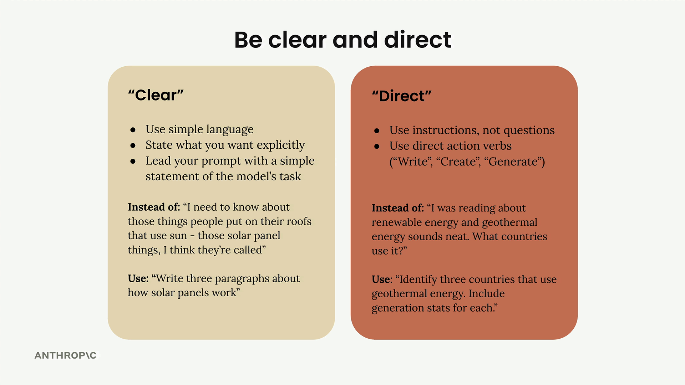
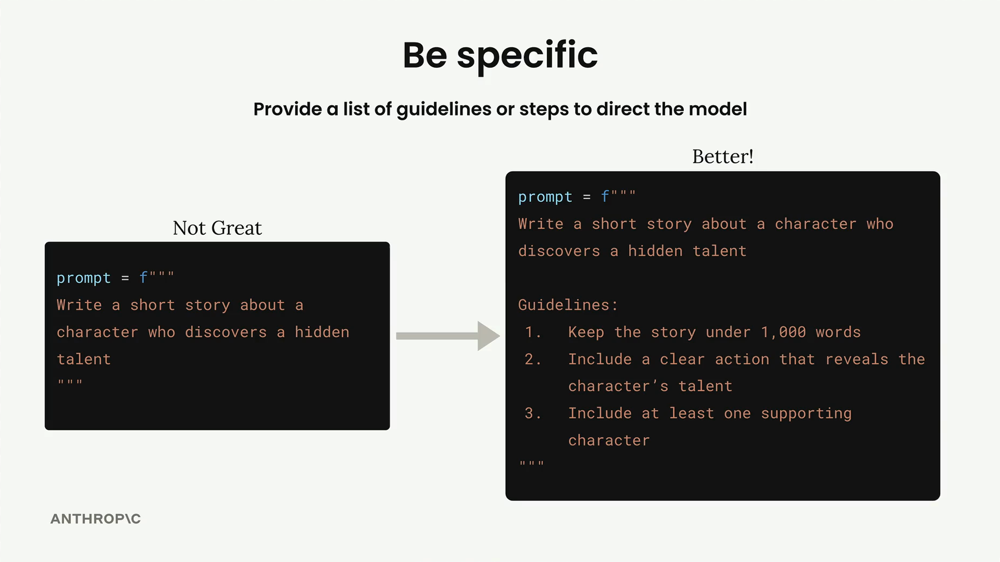

# Prompt engineering techniques

## Being clear and direct



- Use simple language that anyone can understand
- State exactly what you want without beating around the bush
- Lead with a straightforward statement of Claude's task

- Use instructions, not questions
- Start with direct action verbs like "Write," "Create," or "Generate"

- Example: "What should this person eat?" -> "Generate a one-day meal plan for an athlete that meets their dietary restrictions."

## Being specific



### Two Types of Guidelines

#### Output Quality Guidelines

- Length of the response
- Structure and format
- Specific attributes or elements to include
- Tone or style requirements

#### Process Steps

1. Brainstorm three talents that would create dramatic tension
2. Pick the most interesting talent
3. Outline a pivotal scene that reveals the talent
4. Brainstorm supporting character types that could increase the impact

#### When to Use Each Approach

- Always Use Output Guidelines
- Use Process Steps For Complex Problems
- Can combine both approaches

## Structure with XML tags

- `<sales_records>` is better than `<data>`
- `<athlete_information>` clearly identifies user details
- `<my_code>` and `<docs>` separate different types of content

```xml
<athlete_information>

- Height: 6'2"
- Weight: 180 lbs
- Goal: Build muscle
- Dietary restrictions: Vegetarian
  </athlete_information>

Generate a meal plan based on the athlete information above.
```

## Providing examples

- Always use XML tags to structure your examples clearly
- Be explicit about what you're showing: "Here is an example input with an ideal response"
- Include examples that address your most common failure cases
- Explain why your example outputs are considered ideal
- Keep examples relevant to your specific task

- A clear positive example: "Great game tonight!" → "Positive"
- A sarcastic example: "Oh yeah, I really needed a flight delay tonight! Excellent!" → "Negative"
- Context explaining why sarcasm should be treated carefully

## Tool use with Claude
