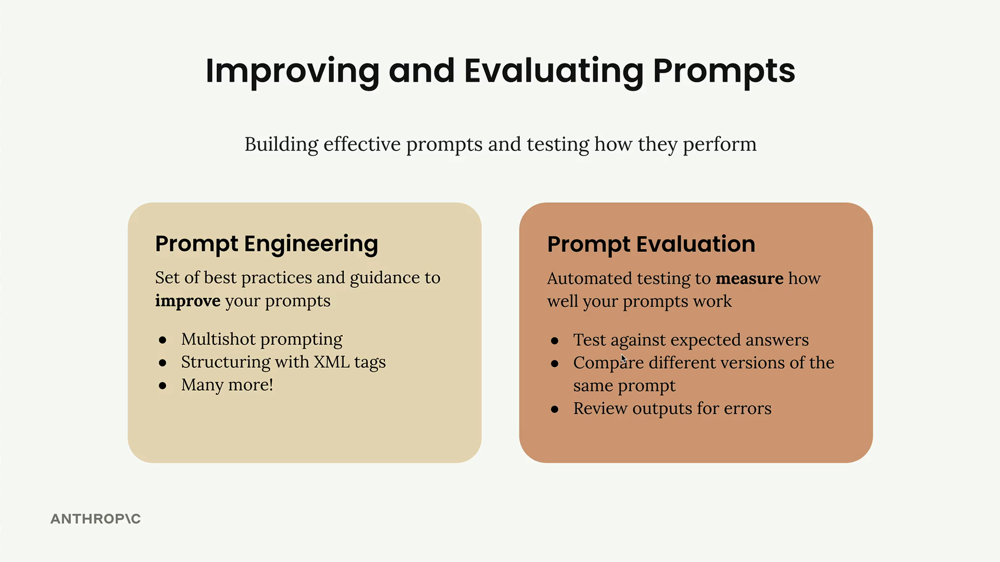

# Claude Partner Network Learning Path

## Getting started with Claude.ai

1. **Setting the stage**: What is your role and what are your objectives? Is there context about your work that Claude should know about?
2. **Defining the task**: What action do you want Claude to take? Do you want Claude to write, analyze, build, or something else?
3. **Specifying rules**: What's the style or tone you want Claude to use? Are there examples that you can attach to show Claude what you're looking for?

The 4D Framework for AI Fluency, developed through research collaboration between Professor Rick Dakan (Ringling College of Art and Design) and Professor Joseph Feller (University College Cork), identifies four core competencies that, when combined, can help you make the most of your AI interactions:

- **Delegation**: Deciding on what work should be done by humans, what work should be done by AI, and how to distribute tasks between them. Includes understanding your goals, AI capabilities, and making strategic choices about collaboration.
- **Description**: Effectively communicating with AI systems. Includes clearly defining outputs, guiding AI processes, and specifying desired AI behaviors and interactions.
- **Discernment**: Thoughtfully and critically evaluating AI outputs, processes, behaviors and interactions. Includes assessing quality, accuracy, appropriateness, and determining areas for improvement.
- **Diligence**: Using AI responsibly and ethically. Includes making thoughtful choices about AI systems and interactions, maintaining transparency, and taking accountability for AI-assisted work.

## Prompt Evaluation

Option 1: Test the prompt once and decide it's good enough. This carries a significant risk of breaking in production when users provide unexpected inputs.

Option 2: Test the prompt a few times and tweak it to handle a corner case or two. While better than option 1, users will often provide very unexpected outputs that you haven't considered.

Option 3: Run the prompt through an evaluation pipeline to score it, then iterate on the prompt based on objective metrics. This approach requires more work and cost, but gives you much more confidence in your prompt's reliability.

1 & 2 are not enough! Only route 3 will cover enough edge cases!
